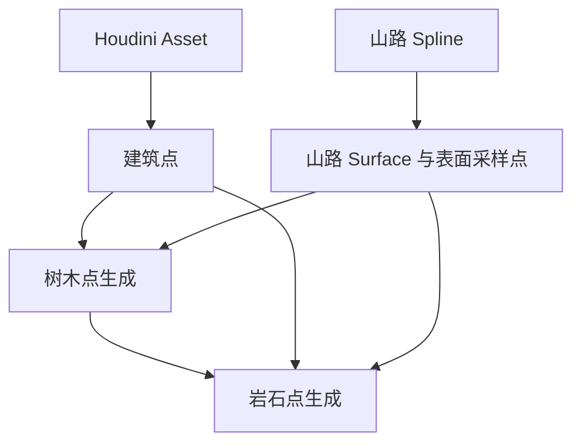

# MountainRoad

基于 Unreal Engine 5.8 的场景工程，包含 PCG、Houdini 数字资产（HDA）、材质与纹理资源。默认场景为 `Content/Map.umap`。

## 通过 HDA Asset 导入路面 Mesh 和地形

项目的路面几何与地形通过 Houdini Engine 的 HDA Asset 工作流进入 UE。HDA 资产入口为 `Content/HDAs/mount_road-1_0.uasset`；项目还提供了编辑器工具蓝图 `Content/EUW_ImportHDA.uasset`，用于搭建输出选择和生成、Bake 操作。工具界面的最终连接与运行结果以当前蓝图为准。

### 导入资产与选择输出

1. 在 Houdini 中保存 HDA 定义到 `.hda` 文件。仅保存 `.hip` 场景文件不等于更新 HDA 定义。
2. 首次使用时，将 `.hda` 导入 UE 内容浏览器；本项目已有导入后的 `mount_road-1_0` 资产。
3. 将该资产拖入关卡创建 Houdini Asset Actor，或在 EUW 中通过 `ProcessHDA` 创建实例。根据 HDA 的实际输入要求设置输入。
4. 在实例参数面板或工具复选框中选择输出，再执行 Cook。

四个选项分别控制以下输出，可根据需要组合开启：

| 选项 | HDA 内部参数 | 功能描述 |
| --- | --- | --- |
| 输出路面网格（Output Mesh） | `output_mesh` | 输出山路的路面 Mesh 几何，用于构成 UE 场景中可见的道路实体。需要生成或更新路面模型时开启。 |
| 输出地形（Output Terrain） | `output_terrain` | 输出地形数据，在 UE 中生成 Landscape，作为道路及周边环境的地形基础。需要生成或更新地形时开启。 |
| 输出建筑点（Output Building Pts） | `output_building_pts` | 输出建筑布置点，提供建筑位置数据。PCG 主图通过 Houdini Asset 获取这些点，并将其用于树木点与岩石点的分布计算；该选项输出的是点数据。 |
| 输出道路表面数据（Output Road Surface） | `output_road_surface` | 输出道路表面相关数据，供后续道路区域处理使用。PCG 主图中的道路 Surface 采样由山路 Spline 生成，并与建筑点共同参与环境点分布计算；该选项与路面 Mesh 输出独立。 |

只更新路面时开启 `output_mesh`；只更新地形时开启 `output_terrain`；需要两者时同时开启。其他两项按后续 PCG 的数据需求选择。修改现有实例参数会影响其当前输出，执行前应确认要保留的输出项。

## 具体功能与资源入口

以下说明结合资源文件、PCG 资产中可读取的节点类型和引用整理。节点存在不代表所有分支都在当前场景中执行；参数数值、连线和最终效果仍以编辑器为准。

### 1. 山路程序化生成与总流程

主图入口为 `Content/PCG/PCG_MountRoad.uasset`。主图通过 Houdini Asset 获取建筑点，同时通过山路 Spline 构建山路 Surface 并生成表面采样点，再利用山路 Surface 数据和建筑点生成树木点；岩石点生成同时使用山路 Surface 数据、建筑点和树木点。



建筑点提供建筑位置数据，山路 Surface 及其采样点提供道路区域数据，两者先参与树木点生成；岩石点生成还需要使用树木点，因此应在树木点生成后执行。树木与岩石的具体筛选、距离计算和分布设置，分别在对应子图中调整。

主图中的 Houdini Asset 用于取得建筑点；通过 HDA 导入路面 Mesh 和 Landscape 的流程另见“通过 HDA Asset 导入路面 Mesh 和地形”章节。

### 2. 基于山路 Spline 的 Surface 采样

入口：`Content/PCG/PCG_RoadSurface.uasset`。

该子图获取山路 Spline，构建山路 Surface，并对 Surface 进行采样，生成道路表面采样点。其结果与 Houdini Asset 输出的建筑点一起，参与后续树木点与岩石点的生成。

修改道路形状后，需要更新这一路 Surface 和采样结果，再更新树木、岩石分布。调整时重点检查 Spline 来源、Surface 范围、采样设置及下游连接。

### 3. 可复用距离过滤

入口：`Content/PCG/PCG_DistanceFilter.uasset`。树木与岩石子图共用这段距离过滤逻辑，用于实现距离道路越近、分布越稀疏的效果。

子图接收 `MinDistance` 和 `MaxDistance`，根据点到道路的距离计算保留概率，再按概率筛选点：

| 距离范围 | 保留规则 |
| --- | --- |
| 小于 `MinDistance` | 直接删除，保留概率为 0 |
| `MinDistance` 到 `MaxDistance` 之间 | 保留概率在 0 与 1 之间插值，随距离增加而提高 |
| 大于 `MaxDistance` | 保留概率为 1 |

因此，道路附近先形成无点区域，随后逐渐过渡到稀疏分布，远处则不再因这项距离过滤损失点。保留概率为 1 只表示通过当前距离过滤，后续节点仍可能继续筛选这些点。

调整 `MinDistance` 可以改变道路附近完全排除点的范围；调整 `MaxDistance` 可以改变从稀疏分布过渡到完整保留的距离范围。配置时应保证 `MaxDistance` 大于 `MinDistance`。

### 4. 树木程序化布置

入口：`Content/PCG/PCG_Tree.uasset`。该子图利用山路 Surface 数据和建筑点生成树木点，再通过静态网格生成节点布置树木实例。

图中同样包含地形读取、表面采样、距离计算、密度过滤、点变换、自修剪及静态网格生成节点，并引用 `PCG_DistanceFilter`。这为按地形与距离条件筛选树木候选点、控制分布以及放置实例提供了基础。

树木与岩石拆分为独立子图，便于分别检查模型、采样密度、实例变换和分布范围。是否实现道路避让，以及避让对象与宽度，应检查 Distance 和 Difference 的实际输入。

### 5. 岩石程序化布置

入口：`Content/PCG/PCG_Rocks.uasset`。该子图利用山路 Surface 数据、建筑点和树木点生成岩石点，再通过静态网格生成节点布置岩石实例。树木点是岩石生成的上游输入，调整树木分布后也需要更新岩石分布。

已识别的处理能力包括：

- 获取地形数据并进行表面采样，建立候选点。
- 计算距离、执行密度过滤，并调用公共距离过滤子图。
- 使用属性噪声和点变换节点调整点数据。
- 使用 Self Pruning 节点进行点集自修剪，再通过 Static Mesh Spawner 生成网格实例。

调整岩石效果时，应检查生成器所用网格、采样设置、距离范围、点变换及修剪规则。节点的实际连接顺序与随机参数需要在图内确认。

### 6. 道路与地形材质

以下路径相对于 `Content/`，名称及对应关系已按当前资源文件和材质资产中的引用重新核对。

| 材质资源 | 对应纹理 / 资源 | 用途 |
| --- | --- | --- |
| `Materials/M_Road_01` | `Textures/Road/T_Asphalt_01_BaseColor`、`T_Asphalt_01_Normal`、`T_Asphalt_01_Roughness` | 第一组沥青路面材质 |
| `Materials/M_Road_02` | `Textures/Road/T_Asphalt_02_BaseColor`、`T_Asphalt_02_Normal`、`T_Asphalt_02_Roughness` | 第二组沥青路面材质 |
| `Materials/M_RoadEdge` | `Textures/Edge/T_RoadsideDirt_01_BaseColor`、`T_RoadsideDirt_01_Normal`、`T_RoadsideDirt_01_Roughness` | 道路边缘泥土材质 |
| `Materials/M_RoadLine` | `Textures/T_RoadWhiteLine_TwoWay_Alpha` | 道路白线材质 |
| `Materials/M_Landscape` | `Textures/Sand/T_Sand_*`、`Textures/Gravel/T_Gravel_*`，以及 `RVT_Road` | 地形材质，包含沙地、碎石纹理和道路 RVT 引用 |

同一行省略目录的纹理名称均位于该行首个纹理的目录中。上述纹理组的通道后缀统一为 `BaseColor`、`Normal`、`Roughness`，分别表示基础颜色、法线和粗糙度。

另外，`Textures/Edge/T_RoadsideDirt_02_*` 和 `Textures/Pebble/T_Pebble_*` 仍保存在工程中，但本次读取的上述五份材质引用中未发现它们；这不代表它们在整个工程中都未使用。

当前保留的运行时虚拟纹理资源是 `Content/RVT_Road.uasset`，并被 `M_Landscape` 引用。旧的 `M_Lanscape` 与 `RVT_LandscapeHeight` 重定向已清理，不再作为独立资源列出。RVT 的具体写入、采样连线及最终融合效果仍以材质图和场景设置为准。

## 环境要求

- Unreal Engine **5.8**（以 `MountainRoad.uproject` 的引擎关联为准）。
- 工程内附 Houdini Engine 插件，版本标识为 **3.0 - H22.0.368**；需要编辑或重新生成 HDA 时，请准备匹配的 Houdini 环境及适用许可。

## 目录结构

```text
MountainRoad/
├── MountainRoad.uproject       # Unreal 工程入口
├── Config/                     # 引擎、输入及项目配置
├── Content/
│   ├── Map.umap                # 默认编辑器场景与游戏地图
│   ├── HDAs/                   # Houdini 数字资产
│   ├── HoudiniEngine/           # Houdini 相关资源
│   ├── PCG/                    # 程序化内容生成资源
│   ├── Materials/              # 材质资源
│   ├── Textures/               # 纹理资源
│   ├── __ExternalActors__/     # 地图外部 Actor 数据
│   └── __ExternalObjects__/    # 地图外部对象数据
├── Plugins/Runtime/HoudiniEngine/
│                               # 项目内 Houdini Engine 插件
└── Source/
    ├── MountainRoad/           # 主运行时 C++ 模块
    ├── MountainRoad.Target.cs
    └── MountainRoadEditor.Target.cs
```
